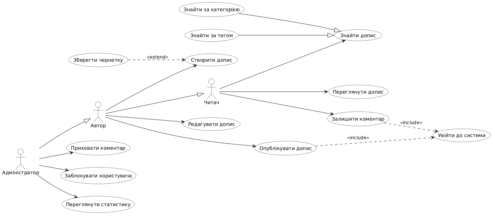
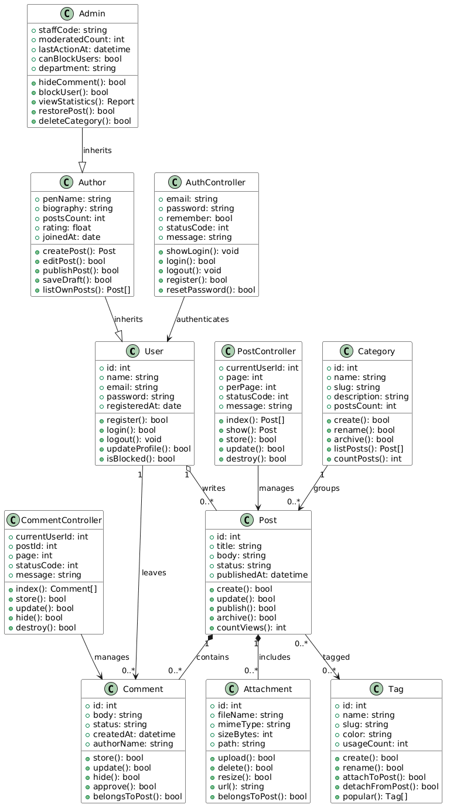

# Інтернет-блог

Веб-система для публікації текстових дописів, коментарів і перегляду статистики. Далі її можна зібрати на PHP/Laravel за схемою MVC: моделі зберігають дані, контролери приймають дії користувача, представлення показують сторінки.

## Характеристики системи

Призначення: дати автору місце для публікації дописів, а читачу — спосіб знайти допис, прочитати його і залишити коментар. Адміністратор стежить за порядком і дивиться статистику.

Основні функції:

- реєстрація і вхід до системи;
- створення, редагування і публікація допису;
- пошук допису за категорією і за тегом;
- коментування опублікованого допису;
- модерація: приховати коментар або заблокувати користувача;
- перегляд статистики переглядів.

Користувачі:

- читач переглядає стрічку, шукає дописи і коментує;
- автор робить усе те саме і ще створює та публікує власні дописи;
- адміністратор робить усе те саме, що автор, і додатково модерує блог.

Архітектура: Laravel MVC. Model — класи `User`, `Author`, `Admin`, `Post`, `Comment`, `Category`, `Tag`, `Attachment`. Controller — `AuthController`, `PostController`, `CommentController`. View — сторінки стрічки, допису, форми і звіту.

Сценарії роботи:

1. Читач відкриває допис за посиланням і читає текст.
2. Автор створює допис, додає категорію, теги й зображення, потім публікує його.
3. Адміністратор бачить скаргу, ховає коментар і за потреби блокує обліковий запис.

Логічні сутності та таблиці бази даних:

- `users` — облікові записи;
- `posts` — дописи;
- `comments` — коментарі;
- `categories` — категорії;
- `tags` — теги;
- `post_tag` — зв’язок допису і тегів;
- `attachments` — файли, прикріплені до допису.

Вихідні дані:

- таблиця дописів на головній сторінці;
- звіт популярних дописів за вибраний період;
- графік кількості переглядів за останні сім днів.

Назви класів англійською і в однині, як моделі Eloquent. Laravel сам утворить назви таблиць у множині: `User` стане таблицею `users`, `Post` — `posts`.

## Use case у короткій формі. Переглянути допис

Читач відкриває головну сторінку блогу, обирає допис зі стрічки або переходить за прямим посиланням. Система показує заголовок, текст, категорію, теги, зображення і список видимих коментарів. Лічильник переглядів збільшується на одиницю.

## Use case у поверхневій формі. Залишити коментар

Головний сценарій. Читач відкриває опублікований допис і натискає поле коментаря. Якщо він ще не увійшов, система просить увійти. Читач пише текст і надсилає його. Система зберігає коментар зі статусом «видимий» і показує його під дописом.

Альтернативні сценарії. Якщо пароль невірний, система не відкриває форму і просить спробувати ще раз. Якщо текст порожній, коментар не зберігається і під полем з’являється підказка. Якщо адміністратор раніше заблокував обліковий запис, система відмовляє в публікації. Якщо допис знято з публікації, поки читач писав коментар, система повідомляє, що коментувати вже не можна.

## Use case у повній формі. Опублікувати допис

**Use Case Name:** Опублікувати допис.

**Scope:** система «Інтернет-блог» (System).

**Level:** User-goal.

**Primary Actor:** автор.

**Stakeholders and interests:**

1. Автор хоче швидко опублікувати текст без втрати чернетки.
2. Читач хоче бачити у стрічці лише готові дописи з правильною категорією.
3. Адміністратор хоче, щоб опублікований допис можна було знайти, перевірити і за потреби зняти.
4. Власник блогу хоче зберігати дописи в базі і бачити кількість переглядів.

**Preconditions:** автор має обліковий запис і не заблокований. У системі є хоча б одна категорія.

**Success guarantee:** допис збережено зі статусом «опубліковано», він видимий у стрічці, у нього є категорія, а перегляди починаються з нуля.

**Main Success Scenario:**

1. Автор відкриває головну сторінку блогу.
2. Автор натискає «Увійти».
3. Автор вводить email і пароль.
4. Система перевіряє обліковий запис і відкриває панель автора.
5. Автор обирає «Новий допис».
6. Автор вводить заголовок.
7. Автор вводить текст допису.
8. Автор обирає категорію зі списку.
9. Автор додає один або кілька тегів.
10. Автор додає зображення до допису.
11. Автор натискає «Опублікувати».
12. Система зберігає допис, категорію, теги і файл зображення.
13. Система ставить статус «опубліковано» і час публікації.
14. Система показує допис у загальній стрічці.

**Extensions:**

1. Невірний пароль на кроці 4. Система не відкриває панель і показує помилку. Автор може ввести пароль ще раз або припинити роботу.
2. Порожній заголовок на кроці 11. Система не зберігає допис і підсвічує поле заголовка. Автор заповнює його і повторює публікацію.
3. Категорію не обрано на кроці 11. Система не публікує допис і просить обрати категорію.
4. Файл зображення більший за дозволений розмір на кроці 10. Система відхиляє файл і лишає автора на формі. Автор обирає інший файл або публікує допис без зображення.
5. Автор натискає «Зберегти чернетку» замість «Опублікувати». Система зберігає допис зі статусом «чернетка». У стрічці його не видно, автор може повернутися до нього пізніше.
6. Адміністратор блокує автора, поки форма ще відкрита. На кроці 11 система відмовляє в публікації і показує, що обліковий запис заблоковано.

**Special Requirements:**

1. Форма допису лишається читабельною на екрані ноутбука і на телефоні.
2. Збереження допису після натискання «Опублікувати» займає не більше трьох секунд за звичайного з’єднання.
3. Чернетка не потрапляє в загальну стрічку і в пошук.

**Technology and Data Variations List:**

1. Вхід виконується email і паролем. Пізніше можна додати вхід через зовнішній акаунт, але в цій версії його немає.
2. Зображення передається з комп’ютера автора як файл.
3. Теги автор обирає з уже створених або вписує новий рядок. Новий тег система створює сама.

**Frequency of Occurrence:** близько 70 % сеансів автора закінчуються публікацією або збереженням чернетки.

**Miscellaneous:**

1. Чи потрібна окрема черга на перевірку допису адміністратором перед показом у стрічці?
2. Чи можна кільком авторам редагувати один допис?

## Діаграми

Діаграма варіантів використання містить акторів «Читач», «Автор» і «Адміністратор». У кожного є три власні варіанти. Автор узагальнює читача, адміністратор узагальнює автора. Публікація допису і коментар завжди включають вхід до системи. Збереження чернетки розширює створення допису. Пошук за категорією і пошук за тегом є частковими випадками пошуку допису.

Діаграма класів містить одинадцять класів. У кожного є щонайменше п’ять атрибутів і п’ять операцій. `Author` наслідує `User`, `Admin` наслідує `Author`. Допис агрегатно належить користувачу: допис може лишитися, якщо автора пізніше від’єднають. Коментарі і вкладення входять до допису композицією: без допису їх не існує. Зв’язок допису з тегами і категорією є асоціацією. Контролери керують відповідними класами.

